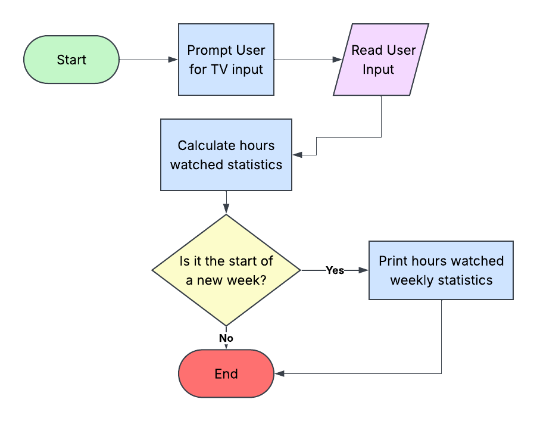

# TV Time

A program where a user can input a TV show and hours watched, and at the end of each week, gets a summary of their total watch time.

## The Problem

As a big TV enjoyer, sometimes I sit down and watch my favorite TV shows for hours. Kind of like Letterboxd, I wish there was a way that I could log what I've watched and how much time I've spent watching it.

## How It Works

I want to build a program where the user can import all their hours they've watched TV and what they've watched, and at the end of the week (or when the user requests it), the program will give the user the number of hours they've watched that week. 

## Tech Stack

- **Language:** Java
- **Libraries:** OpenCSV, LocalDate, ArrayList

## Roadmap

- [ ] User can request statistics from a specific time period
- [ ] Add a rating system
- [ ] Report back what the user’s most highly rated TV was

## Author

Ivy Spratt, https://github.com/ivyspratt
